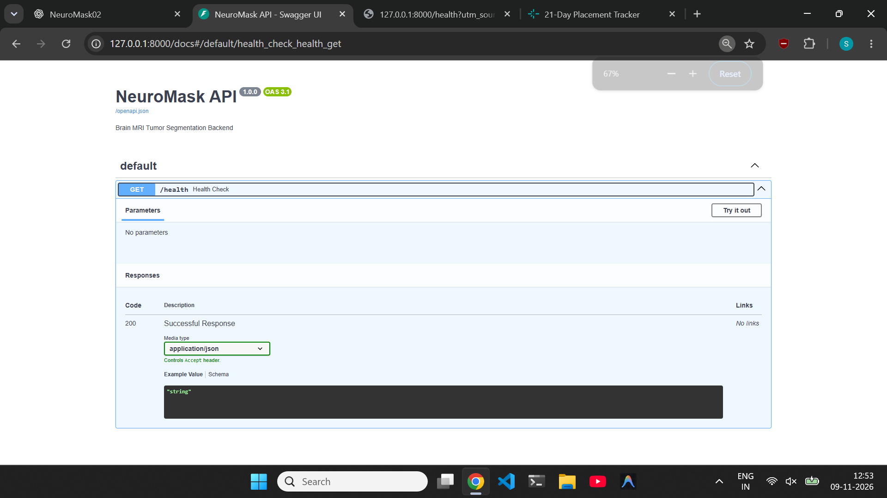
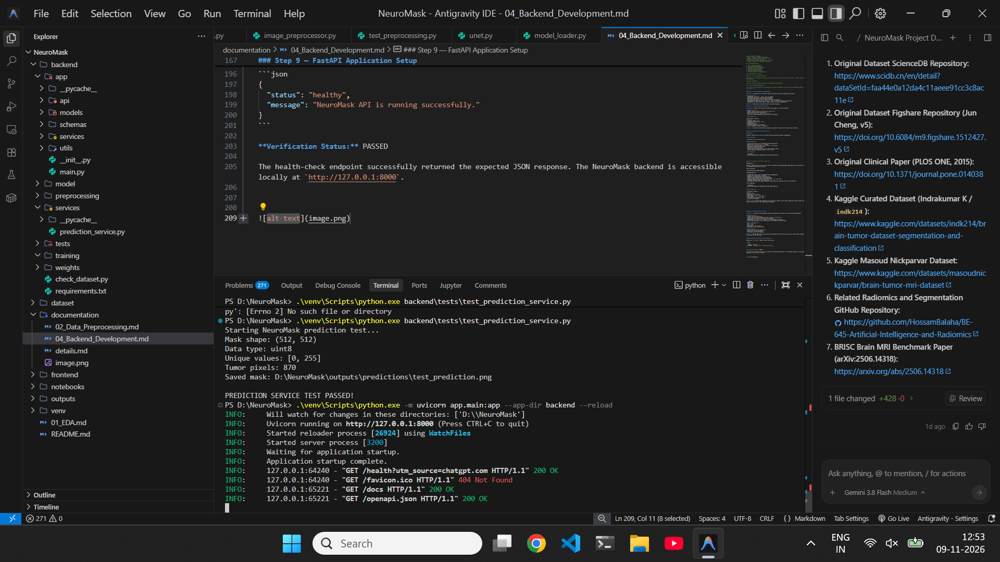

<!-- # Phase 4 — Backend Development

## 1. Objective

Develop a backend service for NeuroMask using FastAPI and PyTorch. The backend will load the previously trained U-Net model and provide an API for brain MRI tumor segmentation.

## 2. Technology Stack

- Python
- FastAPI
- PyTorch
- NumPy
- Pillow
- Uvicorn

## 3. Backend Architecture

The backend will contain the following modules:

| Module | Responsibility |
|---|---|
| API | Handle HTTP requests |
| Models | Define the U-Net architecture |
| Schemas | Validate request and response data |
| Services | Handle model inference |
| Preprocessing | Prepare MRI images for inference |
| Weights | Store the trained model checkpoint |

## 4. Development Steps

1. Verify Python environment.
2. Install backend dependencies.
3. Implement the U-Net architecture.
4. Load the trained checkpoint.
5. Implement MRI preprocessing.
6. Develop the prediction API.
7. Test API endpoints using Swagger UI.

## 5. Implementation Progress

### Step 1 — Initial Backend Structure

Created the initial backend directories and starter files for API routes, model architecture, schemas, services, and utilities.

**Status:** Completed.

**Next:** Python environment verification and dependency installation.

## 6. Final Implementation Results

This section will be updated after completing each backend development step with actual implementation details and test outputs. -->


### Step 6 — U-Net Architecture Implementation

**Objective:** Reconstruct the original U-Net architecture used during Google Colab training.

**Implementation:**
- Implemented `DoubleConv`, `Down`, and `Up` modules.
- Implemented the encoder, bottleneck and decoder.
- Used skip connections between encoder and decoder.
- Set convolution bias to `False` to match the trained checkpoint.
- Implemented the bottleneck using `Down(512, 1024)` to match the original architecture.
- Configured one input channel and one output channel for binary segmentation.

**Status:** Architecture corrected to match the saved checkpoint.

### Step 7 — Trained Checkpoint Restoration

**Objective:** Restore the previously trained U-Net weights in the local backend.

**Implementation:**
- Loaded `outputs/checkpoints/neuromask_best_model.pth`.
- Reconstructed the U-Net architecture.
- Used `load_state_dict()` with `strict=True`.
- Verified all model parameters against the saved checkpoint.

**Actual Results:**

| Verification | Result |
|---|---:|
| Checkpoint epoch | 19 |
| Checkpoint state entries | 118 |
| Missing keys | 0 |
| Unexpected keys | 0 |
| Trainable parameters | 31,036,481 |
| Strict checkpoint loading | Successful |

**Status:** Previously trained U-Net checkpoint successfully restored. No retraining was performed.


### Step 8 — Reusable MRI Preprocessing Test

**Objective:**

Created a reusable test script to validate the MRI preprocessing module independently.

**File Created:**

`backend/tests/test_preprocessing.py`

**Implementation:**

- Located the project root and backend directory dynamically.
- Imported the `preprocess_mri()` function.
- Used a real Glioma MRI image (`enh_1849.png`) for testing.
- Validated the output tensor shape.
- Checked the tensor data type.
- Verified that normalized pixel values remain between 0 and 1.
- Checked numerical stability using `torch.isfinite()`.

**Test Command:**

```powershell
.\venv\Scripts\python.exe backend\tests\test_preprocessing.py


### Step 9 — Reusable U-Net Model Loader Test

**Objective:**

Created a reusable test script to verify that the previously trained NeuroMask U-Net model can be restored from its checkpoint and perform inference.

**File Created:**

`backend/tests/test_model_loader.py`

**Implementation:**

- Located the project root and backend directory dynamically.
- Imported the `load_model()` function.
- Loaded the existing trained U-Net checkpoint.
- Verified that the model was in evaluation mode.
- Created a dummy grayscale MRI tensor with shape `(1, 1, 128, 128)`.
- Performed inference using `torch.no_grad()`.
- Validated the prediction output shape and checked numerical stability using `torch.isfinite()`.

**Test Command:**

```powershell
.\venv\Scripts\python.exe backend\tests\test_model_loader.py
```

**Actual Results:**

| Validation | Result |
|---|---|
| Device | CPU |
| Model Mode | Evaluation |
| Input Shape | `(1, 1, 128, 128)` |
| Output Shape | `(1, 1, 128, 128)` |
| All Output Values Finite | True |
| Overall Test | PASSED |

**Status:** The trained U-Net checkpoint was successfully loaded, and the model completed a dummy inference pass without numerical errors. No retraining was performed.


### Step 9 — FastAPI Application Setup

**Objective:** Initialize the NeuroMask backend using FastAPI and create an initial health-check endpoint.

**Implementation:**
- Created `backend/app/main.py`.
- Initialized the FastAPI application with the title `NeuroMask API`.
- Added project description and API version metadata.
- Implemented the `GET /health` endpoint to check backend availability.
- Started the development server using Uvicorn with automatic reload enabled.

**Server Configuration:**
- Host: `127.0.0.1`
- Port: `8000`
- Application: `app.main:app`
- Development mode: Reload enabled

**Actual Result:**
- Uvicorn server started successfully.
- Application startup completed.
- No startup errors were reported.

**Status:** FastAPI application initialized and development server running successfully. Browser-based endpoint verification is the next step.


**Health Endpoint Verification — Actual Result**

Tested the `GET /health` endpoint using a web browser.

```json
{
  "status": "healthy",
  "message": "NeuroMask API is running successfully."
}
```

**Verification Status:** PASSED

The health-check endpoint successfully returned the expected JSON response. The NeuroMask backend is accessible locally at `http://127.0.0.1:8000`.






## Step — Real MRI API Prediction Testing

### Objective
Verify that the NeuroMask prediction API accepts an actual brain MRI image and returns a segmentation mask successfully.

### Testing Configuration
- **API:** `POST /api/predict`
- **Input image:** `enh_209.png`
- **Testing interface:** FastAPI Swagger UI
- **Local server:** `http://127.0.0.1:8000`

### Implementation
1. Opened the prediction endpoint in Swagger UI.
2. Uploaded an actual Glioma MRI image.
3. Submitted the image using the Execute button.
4. The backend passed the image to the prediction service.
5. The trained U-Net generated a segmentation prediction.
6. The API returned the predicted mask as a PNG image.

### Actual Test Results

| Test | Result |
|---|---|
| MRI upload | Successful |
| API endpoint | Successful |
| HTTP status | 200 OK |
| Response content type | image/png |
| Segmentation mask | Generated successfully |

### Output
The API returned a binary segmentation mask containing:
- White pixels (255): Predicted tumor region.
- Black pixels (0): Background.

### Conclusion
The NeuroMask backend successfully processed an actual MRI image and returned a segmentation mask through the FastAPI prediction endpoint.

**Status: REAL MRI API TEST PASSED**

Note: Prediction accuracy for this individual image has not yet been established through comparison with its ground-truth mask.